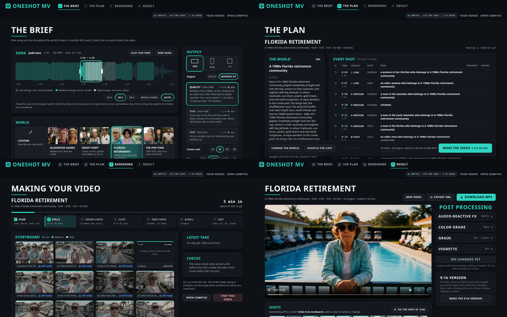
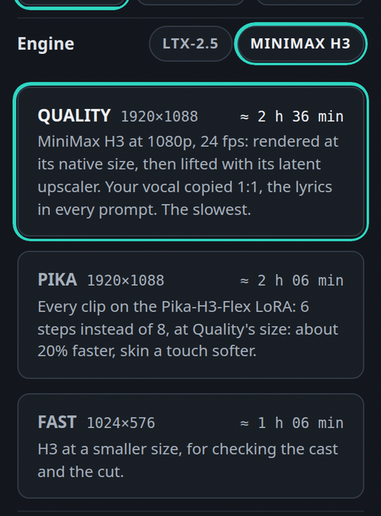

# OneShot MV

Give OneShot MV a song and one line about the world it lives in ("the gladiator games in ancient
Rome"). It listens to the song, invents a cast for that world, plans every shot around the song's
energy, and renders a lip-synced music video where a different invented person sings each line.
Everything runs locally in ComfyUI on open-weights models.


> Made for Comfy's Open Source Higgsfield challenge. Every face in this repo and in the videos it
> makes is invented. Use music you have the rights to.

## What it does

1. It analyses the song: beats, bars, sections, loudness, the drop, and the vocal and drum stems.
2. It turns your line into a World: who the people are, what they wear, where each scene happens,
   the light and the camera.
3. It plans the cut by energy. Each part of the song is low, medium or high energy, and each level
   is cut its own way: long shots in the quiet parts, a cut every bar in the verses, a new face on
   the beat in the chorus or drop.
4. Krea 2 paints a portrait of every performer, each one a different person.
5. A vision check looks at every portrait (one person, the right gender, the whole head in frame,
   no writing, nothing from after the World's period, the right outfit) and redoes the wrong ones.
6. The video engine turns each portrait into a clip that sings the isolated vocal: LTX-2.5
   (the default), or MiniMax H3, which copies the vocal 1:1 and is told the sung words (Whisper
   transcribes them). Each engine gets its prompts in its own structure. Over an instrumental
   stretch (an instrumental drop, a break) the singers don't sing: they move to the music with
   their mouths closed.
7. A take check re-shoots missing, frozen or blown-out takes, dead mouths, takes that drift to
   another person or place, bad framing, and weak lip sync (scored with SyncNet).
8. A few shots become b-roll: a World character in a candid moment, not singing (instrumental
   stretches first), or your own cutaways from the B-roll box (see [B-roll](#b-roll)).
9. It cuts everything on the beat, adds audio-reactive FX driven by the drums, then a color grade,
   grain at 1080p and a vignette. You get an MP4, an EDL and a Final Cut Pro XML.

## Three ways to run it

| | Who it's for | What it is |
|---|---|---|
| The Studio (recommended) | Everyone | An app inside ComfyUI: the brief, the plan, live rendering, the result, post processing and re-shoots. |
| The ComfyUI workflow | People who build in ComfyUI | The Director node with every setting, or the same run in ComfyUI's App mode. |
| The Comfy SDK | Scripts and automation | `run_sdk.bat` or `sdk_run.py`: one command takes a song and a World line to an MP4. |

All three drive the same nodes, and every run shows up in the Studio under Your videos.

### The Studio

With ComfyUI running, open http://127.0.0.1:8188/oneshot-mv/ or click **cnforge Studio** in
ComfyUI's top bar. ComfyUI serves the page itself, so there is nothing else to install. The
sidebar holds New video, Your videos, the video you're on, the GPU and queue, and **Restart
ComfyUI** (it asks first, and warns when jobs are queued: a restart stops the running job and drops
the waiting ones; the page reloads once ComfyUI is back).



1. **The Brief.** Name the project, then drop in a song. The waveform shows the low, medium and
   high energy sections and the stretch the video will use: drag the box to move it, click or
   drag anywhere to listen from there. No song? **Make one**: Gemma writes lyrics and a style
   for your World (or use your own style and lyrics, or go instrumental), and
   [ACE-Step 1.5](#make-a-song) sings it in a minute or two. The song lands in the input folder
   under `oneshot-mv-songs/` and is picked for you. Optionally add **Characters**, one photo per person (up
   to 8): every singer becomes one of them, taking turns shot by shot (a shot's quick looks stay
   that person), dressed and placed by the World (needs Qwen-Image 2.1 and FLUX.2 klein,
   see [the other models](#models-and-licences); use a photo of someone who agreed to it).
   Pick a length (15, 30 or 60 s, the whole song, or any custom length from 5 s), a World (four examples, or write your own), an optional
   [Direction](#writing-a-direction) (how the video changes from the opening to the last chorus)
   and the output: format, engine
   (LTX-2.5 or MiniMax H3), quality (Ultra, Max, Quality or Fast on LTX-2.5; Quality, More motion, Singularity,
   Pika or Fast on H3), frame rate (24, 25, 30 or 50 fps) and size (720p to 4K, scaled up from the render).
   Advanced holds the editing (how often it cuts, cutaways), the cast (looks in a shot,
   close-ups only, crowd, cast order, seed), the take check's retries, the
   [detail refine](#refine-details) and the model versions.
   The project name is optional (the song's title otherwise). The buttons say how long the plan
   and the video will take.
2. **The video.** One workspace from the plan to the last re-shoot. The song runs along the
   bottom as a timeline: its parts, its waveform, every shot as a thumbnail (orange sung, blue
   cutaway, a red dot where the take check flagged it) and a stripe for who sings it. Click or
   drag the ruler or waveform to scrub, click a shot to pick it, zoom in on short shots. The
   viewer plays the cut, or before there is one, the song over each shot's clip, still or plan.
   Keys: Space plays, ← → step through shots, T and P queue a new take or a new person, W shows
   only flagged shots. The panel on the right has three tabs:
   - **Shot**: the picked shot's clip, who sings it, its take-check score and why it was flagged,
     and what the plan says (wearing, where, its Direction note).
   - **Video**: the World, the cast (click a face for their next shot), the output, shot health,
     and the checks' notes. While it renders, the stages and the latest take.
   - **Finish** (once there's a cut): post processing, below.

   Where the video is decides the buttons at the top:
   - **Plan**: nothing has rendered. Shuffle the cast (plan again with the next seed) or Make
     the video.
   - **Rendering**: the stage, the progress and the time left; the shots fill in on the timeline
     as stills and clips arrive, and the shot being made right now glows with a tag saying what
     it is (Still, Clip, New take or Refining). You can close the tab and come back, or stop the video.
   - **Done**: Download, and Export XML for Premiere Pro or DaVinci Resolve (every clip with its
     in and out points). From here you can:
     - Re-shoot shots. Pick one and choose New take (same person and still) or New person (a new
       still first), with an optional note ("a woman in her seventies, in bright sun"). In a
       shot with looks (the quick cut-ins of other looks), you can pick just one of them. **New
       takes for every flagged shot** (Video tab) queues them all. Re-shoot shoots only those,
       together; everything else stays, the video is cut again, and the cut before stays as a
       version you can switch back to under the viewer.
     - Make a 9:16 version of a 16:9 video (Finish tab): each shot cropped around the singer's
       face, held still or following them, never moving across a cut (softer than rendering at
       9:16).
     - Open in ComfyUI: the sidebar's link opens ComfyUI with the graph that made the video, and
       a shot's panel opens one take's own workflow (runs started in the Studio keep their graph).
     - Change the post processing without re-rendering anything: audio-reactive FX for low,
       medium and high energy sections (None, Subtle or Intense), a color grade (None, Neon
       Saturated, Technicolor, Teal & Orange, Golden Hour, Warm Romantic, Soft Eterna, Low Key,
       Industrial Green or Silver Mono, each previewed on a still from your video), grain with a
       pixel-for-pixel 1080p preview, and a vignette. Apply changes makes the new cut in about
       two minutes.

   **Edit brief** (at the top, the Brief step and the sidebar's This video card) opens the brief
   that made the video in the Brief, with every setting, the song and the photos. Change anything
   and preview or render: it starts a new video, and the original stays.
3. **Your videos** lists every run, whether it came from the Studio, the workflow or the SDK.

Every video starts with FX on Subtle, no color grade (a natural base grade is always applied),
grain at 25% and the finest size, and no vignette. Apply and re-shoots keep the cut before
as a version. The project name is used for the run folder and the downloaded files.

To click through every screen on a finished video without rendering anything, open
http://127.0.0.1:8188/oneshot-mv/?demo. Starting a video, rendering, Apply and re-shoots are
simulated there in seconds, and nothing is sent to ComfyUI.

### Film mode: commercials and short films

**New film or ad** in the sidebar makes a video with no singers and no song needed. Write a script, a
treatment or one line, pick what it is (commercial, short film, trailer, documentary) and an
optional style. Gemma writes the film's bible, a cast with fixed descriptions (so a person or a
product looks the same in every shot) and a look, then a shot list. Every shot is text to video on
LTX-2.5 (Fast, Quality, Max, Ultra) or MiniMax H3 (with RelayVSR 2x if you like), and the cut joins
them with:

- **the shots' own sound** (LTX-2.5 and H3 make sound with the picture), normalised,
- **a song** from the input folder, its strongest stretch, every cut moved onto a beat,
- **music made for it** (ACE-Step 1.5, written from the script, instrumental by default), or
- **silence**.

Dialogue: write it as a screenplay (`GEORGE: "My uncle died."`) and every line is kept word for
word and in order, one or two lines a shot, with the speaker in frame; shots without lines are told
that nobody speaks. Without music the film runs as long as its lines need, and the cut listens to
every take (Whisper) and ends each shot just after its last scripted word, so a line is never cut
off and the talk a model makes up to fill a long clip is left out.

**One shot, no cuts** (under Shots) makes the whole piece one continuous take: Gemma writes a
single camera move through the scene with every line in it, and the cut keeps the whole take, with no
edit. One take is at most 15 s on MiniMax H3 and 20 s on LTX-2.5, which is about 30 to 45 spoken
words. When the script's lines need longer, the film's page says so.

The film's page shows the cut, every shot with its description, the bible and the script. Change
the grade and **Re-cut** (nothing re-renders), or **Re-shoot** a shot: it renders a new take and
cuts again. A 15-second ad on LTX-2.5 Fast takes under 2 minutes on an RTX PRO 6000. Films are in
`output/oneshot-mv/films/<name>/`: `final.mp4`, every shot's takes and `film.json`.

### The ComfyUI workflow

Open an example from Templates in the left sidebar, under Extensions, ComfyUI-OneShotMV. You can
also drag a file from `example_workflows/` onto the canvas.

- `OneShotMV_App.json` opens in ComfyUI's App mode: a song, a World line and a few settings, then
  Run. App / Graph at the top left shows the graph behind it.
- `OneShotMV_Voice.json` is the Director with every setting.
- `OneShotMV_Recut.json` cuts a finished run again with other FX or without the finish.
- `OneShotMV_Motion.json` is the experimental motion mode (one dance, many dancers). It needs the
  extra models listed under "Models that only other packs and modes use".

Turn `queue_renders` off and run once to see the plan in the summary without rendering anything.
Then turn it on and run again; the song analysis and the World are cached, so the second run
starts faster. The Director queues every job itself, and the video lands in
`output/oneshot-mv/runs/<run>/final_<format>.mp4`.

### The Comfy SDK

`sdk_run.py` makes a whole video through the [Comfy SDK](https://pypi.org/project/comfy-sdk/). It
uploads the song, runs the Director and prints the shot plan. The run's stages then render in
ComfyUI, a Run Result job waits for the finished video, and the SDK downloads it into
`oneshot_mv_out/`.

Comfy Cloud doesn't install custom node packs yet, so the SDK talks to your own ComfyUI through
Comfy's open-source [`comfy-api-proxy`](https://github.com/Comfy-Org/comfy-api-proxy), which gives
a local ComfyUI the same API as Comfy Cloud. `sdk_run.py` starts the proxy for you; start ComfyUI
first.

On Windows with ComfyUI portable, double-click `run_sdk.bat` in the pack folder. The first time,
it installs `comfy-sdk` and `comfy-api-proxy` into `.sdk\` next to it and leaves ComfyUI's own
packages alone. It asks for the song (drag the file in), the World line and the length. You can
also pass options:

```
run_sdk.bat --song "song.wav" --theme "the gladiator games in ancient Rome" --seconds 40
```

Anywhere else:

```
pip install comfy-sdk comfy-api-proxy
python sdk_run.py --song track.wav --theme "a 1965 airline: pilots, stewardesses and passengers" --preview
python sdk_run.py --song track.wav --theme "a 1965 airline: pilots, stewardesses and passengers" --seconds 30
python sdk_run.py --song track.wav --format 9:16 --fx intense --cuts-high "to the music (intense)"
python sdk_run.py --recut "<run folder>" --fx none
```

`python sdk_run.py --help` lists every option: length and start, format, preset, seed, FX, the
cut for each energy level, cast order, crowd, b-roll share, take-check rounds and the model set. `--preview`
prints the plan without rendering. To use another deployment that has the OneShot MV nodes, set
`COMFY_BASE_URL`, and `COMFY_API_KEY` if it needs one.

## Writing a World

One line is enough. "The gladiator games in ancient Rome" gets you gladiators, an emperor,
senators and noblewomen in the arena, the stands and the imperial box, all in period clothes.

For more control, write it the way the Studio's examples are written: the tone, then the people
in the order you want them, then the places, then the light.

> Tokyo after midnight in the rain, played straight and cinematic like a stylish music video,
> all invented adults in their twenties and thirties: a lead singer in a long black trench coat
> and silver rings, a street dancer in an oversized varsity jacket and cargo pants, a DJ in
> headphones and a bucket hat, a convenience-store clerk in a striped uniform...; a narrow alley
> of glowing signs and wet pavement, a pedestrian crossing in the rain, a tiny ramen bar, a
> karaoke booth...; magenta and cyan neon reflected in puddles, soft rain haze, shallow focus

Some things that help:

- The people you name are cast first, in your order. Set cast order to "mixed" to shuffle them.
- Name the period ("1965", "ancient Rome", "1813"). It keeps modern clothes and objects out, and
  the vision check rejects stills that show them.
- Say the tone: "played straight like an epic film", "over the top", "cinematic".
- Casts are adults only. Give ages when they matter ("in their seventies").
- Say whether it's night or day ("at 3 a.m.", "hard midday sun"), and the light follows.
- For events such as a stadium, a ball or a club, people appear behind the singers, dressed for
  the World. The crowd setting turns this on or off.
- Leave out real people and brands. Brand names are replaced, and signs are kept free of writing.

## Writing a Direction

The World says who and where; the Direction says how the video changes over the song. Write a
line per part of the song, the part, a colon, then the note:

> Opening: quiet, intimate close-ups, almost no magic.<br>
> Verses: playful performance, miniature cities, creative transformations.<br>
> Pre-choruses: wings growing, larger camera movements, building anticipation.<br>
> Choruses: explosive dancing, fast camera movement, spectacular effects.<br>
> Bridge: emotional, cinematic, stripped back.<br>
> Final chorus and outro: maximum spectacle, enormous wings, the whole world built.

- The parts: opening (intro), verses, pre-choruses (builds), choruses (hooks, drops), bridge
  (break), final chorus and outro. One line can name several ("Final chorus and outro: ...").
- A time range in the song works too: "1:12-1:30: the wings fold away".
- A line without a part goes on every shot.
- The song analysis finds the parts from its sections and their loudness. The final chorus is
  the song's last run of chorus shots, and it takes the chorus note when it has none of its own.
- Each shot's note shapes its singer's portrait (up to about 90 words) and its cutaways. The
  singer clips animate that portrait with the performance prompt alone: long notes in the clip
  prompt pushed out the lip-sync wording and the mouths stopped following the words. Cutaway
  clips get the first sentence or two of their part's note.
- Keep notes short and about the picture. Lines about the edit ("Editing rules: ...") are left
  out of the pictures, and a note written for the whole group ("all five together") fits the
  cutaways better than the one-person singer shots.
- A planned video's Shot tab shows which part every shot is in and the note it got, so check it
  there before rendering.

### B-roll

Under the Direction, the B-roll box takes your own cutaways, one per line: a product shot, a
detail, a place ("Cola pouring over ice in slow motion, bubbles rising"). Every cutaway slot takes
the next line, from the top again when there are more slots than lines. Each line is used as you
wrote it for the still and the clip, with only the realism finish added: no language model
rewrites it, and brands you name are kept (made-up text and subtitles are still kept out). Leave it
empty and the cutaways come from the World (Cutaway style). Advanced, Cutaways sets how many: up to
about 1 in 2 shots; writing lines turns cutaways on at 1 in 8 when it is set to none. Cutaways only
go where nobody sings over a drop (quiet and build parts, instrumental drops), never on the
opening shot and never two in a row. On the node, the input is `broll_prompts`.

## Settings

| Setting | Choices | Default |
|---|---|---|
| Length and start | seconds (0 = the whole song); a start time, or auto | 30 s from the strongest stretch |
| Format | 16:9 (1920×1080), 9:16 (1080×1920), 1:1 (1080×1080) | 16:9 |
| Engine | ltx-2.5 (LTX-2.5 distilled, lip sync from the vocal), minimax-h3 (MiniMax H3 reference mode: the portrait, the vocal copied 1:1, the lyrics from Whisper; 24 fps, at least 4.5 s a clip; slower) | ltx-2.5 |
| Quality | ultra (LTX-2.5 only: Max with STG guidance, 40 steps and 1536×2560 at 9:16, about 3½× Max's time for a whole video), max (LTX-2.5 only: Quality's size on the full dev model, about 4× Quality's time), quality (LTX-2.5: clips at 1920×1152 for 16:9, 25 fps; H3: 1920×1088, 24 fps), dynamic (H3 only, "More motion": Quality's size on H3's full reference model at 20 steps, the portrait not pinned as the first frame, prompts that ask for body and camera movement; about 2× Quality's time), singularity (H3 only: More motion on the Singularity ref2va fine-tune, bf16), pika (H3 only: every clip on Pika-H3-Flex at Quality's size, about 20% faster), fast (LTX-2.5: 896×512; H3: 1024×576; for checking the cast and the cut) | quality |
| Cuts, per energy level | every 2 bars, every bar, to the music (subtle), to the music (intense) | low: every 2 bars; medium: every bar; high: to the music (subtle) |
| Audio-reactive FX | none, subtle, intense (per energy level in the Studio) | subtle |
| Refine details | off, on (LTX-2.5 at Quality, Max or Ultra: a Refine-Details IC-LoRA pass over every clip in the cut, see [Refine details](#refine-details)) | off |
| Direction | a note per part of the song (opening, verses, pre-choruses, choruses, bridge, final chorus, outro, or a time range), see [Writing a Direction](#writing-a-direction) | none |
| Cast order | as written, mixed | as written |
| Crowd behind singers | auto, on, off | auto |
| B-roll share | 0 to 0.5 of the shots (Studio: none, 1 in 8, 1 in 4, 1 in 2) | 0.125 |
| Render | full, draft (the same model and quality at 960×544 on MiniMax H3 or Fast's size on LTX-2.5, no RelayVSR or refine; check a run, then render it again on full with the same seed) | full |
| B-roll lines | your own cutaways, one per line ([B-roll](#b-roll)) | empty: from the World |
| Take-check rounds | 0 to 3 | 2 |
| Seed | any number | 1 |
| Models | auto, 24gb (fp8), full (bf16, 48 GB+ GPUs) | auto |

Quality renders at 1080p and above, so a 1080p cut is made from real detail; fast is scaled up
to the delivery size. 9:16 and 1:1 use the same sizes turned or squared (LTX-2.5: 1152×1920 and
1536×1536 at quality, 512×896 and 768×768 at fast; H3: 1088×1920 and 1088×1088, 576×1024 and
640×640). Clips are saved near-lossless (H.264 at crf 10), so the cut is the only real
compression. Runs made before 1080p Quality keep their own sizes (1280×768 on LTX, 1344×768 on
H3) for re-cuts and re-shoots; runs made before the engine choice rendered on LTX-2.3, which is
retired, and their re-cuts and re-shoots still work.

H3 at quality runs its first 6 of 8 steps at its native size (1344×768), lifts the clip with
H3's latent upscaler and runs the last 2 at 1920×1088 ([comfyui-SelfLift](https://github.com/facok/comfyui-SelfLift)
and `minimax_h3_latent_upscaler_3d_fp32.pth` in `models/latent_upscale_models`, from
[LBH-123-AI/Minimax_h3_latent_Upscaler](https://huggingface.co/LBH-123-AI/Minimax_h3_latent_Upscaler)).
It takes about 60% longer than a native-size clip. Without them, H3 quality renders at its
native size and is scaled up. On a GPU with less than 40 GB, quality keeps the earlier sizes
(1280×768 on LTX-2.5, 1344×768 on H3) to fit in memory.

**Upscale: RelayVSR 2x** (Advanced, MiniMax H3) is the other way up from the native size: every H3
clip renders all 8 steps at 1344×768, then [RelayVSR](https://kopperx.github.io/RelayVSR/) doubles
it to 2688×1536 (4 steps, every 15th frame through the model, its Flash decoder restoring the
rest), scaled to the delivery size. It needs a ComfyUI from 6 November 2026 or later (the
RelayVSR Conditioning and VSR Decode nodes) and
[Comfy-Org/RelayVSR](https://huggingface.co/Comfy-Org/RelayVSR)'s
`relayvsr_x2_lightx2v_int8_convrot.safetensors` in `models/diffusion_models` and
`relayvsr_flash_vae_x2_fp32.safetensors` in `models/vae`. Without them H3 falls back to SelfLift.

**Stills: Krea 2 or MiniMax H3 Image** (Output, under the engine) picks the image model. Krea 2
makes the singer portraits and b-roll stills, and Qwen-Image 2.1 edits your character photos.
[MiniMax H3 Image](https://huggingface.co/MiniMaxAI/MiniMax-H3-Image) does all three. Its stills
are made at about 4 MP (2720×1536 for 16:9) in 6 steps, then scaled to the clip size, and photo
edits are scaled to 4 MP first, because the model draws poorly below that. The look keyframes stay
on Klein, which keeps the pose by construction. H3 Image uses H3's text encoder plus
[Comfy-Org/MiniMax-H3-Image](https://huggingface.co/Comfy-Org/MiniMax-H3-Image)'s
`minimax_h3_image_pruned_int8_convrot.safetensors` in `models/diffusion_models` and
`minimax_h3_image_vae_fp16.safetensors` in `models/vae`. Without them a run uses Krea 2.

Max renders LTX-2.5 clips with its full dev model instead of the 8-step distilled one: stage 1
runs 20 steps at cfg 4 (so the negative prompt counts), and the upscale stage runs dev with the
distilled LoRA at 0.6, LTX's own dev recipe. Faces and motion come out cleaner, at about 4× the
time of Quality (a 4.5 s clip: about 3 minutes instead of 45 seconds on an RTX PRO 6000). It
needs `ltx-2.5-22b-dev-transformer` (bf16 in the full set, int8 in the 24 GB set) and
`ltx-2.5-22b-distilled-lora-450-bf16` from [Lightricks/LTX-2.5](https://huggingface.co/Lightricks/LTX-2.5).
Ultra is Max with three more things: stage 1 is guided the way LTX-2's own dev workflows do it
(CFG, STG and cross-modal guidance for picture and sound, through the MultimodalGuider of
[ComfyUI-LTXVideo](https://github.com/Lightricks/ComfyUI-LTXVideo)), it runs 40 steps, and the
upscale stage runs 8 steps instead of 3. Everything is a third bigger: 2560×1536 for 16:9,
1536×2560 for 9:16. On four test shots, Max sometimes drifted off the singer to the people around
them; Ultra kept the singer in frame every time, with finer skin, hair and jewellery. More steps alone,
or STG alone, didn't do that (STG alone came out softer). Each clip takes about 6× Max's time (a whole video about 3½×, as stills and checks take as long on every tier) and needs
the same files as Max; it's meant for a GPU with lots of memory. Ultra's lips run further ahead of
the voice than Max's (about 0.12 s), so its cut shifts them back by that much wherever SyncNet
can't measure a take with confidence.
H3 has no Max or Ultra: its unpruned model, at twice the time, looked no different.

MiniMax H3 needs ComfyUI's MiniMax H3 nodes (a recent ComfyUI), its reference model, the Qwen3-VL
32B H3 text encoder and the H3 video and audio VAEs (`h3_*` in `fv/models.json`); its lyrics come
from OpenAI Whisper (large-v3-turbo, about 1.6 GB, downloaded into `ComfyUI/models/whisper` the
first time). The Studio lists any H3 files the chosen model set is missing.

On H3, b-roll cutaways render on [Pika-H3-Flex](https://huggingface.co/Pika-Labs/Pika-H3-Flex) when
it is installed: its ref2va LoRA (`pika_h3_flex_ref2va_comfy_bf16.safetensors`, 2.0 GB, from the
repo's `comfy/loras`) on H3's pruned ref2va model (`minimax_h3_ref2va_pruned_bf16`, or `_int8_convrot`
in the 24 GB set), with Pika's own 6-step schedule. On cutaways it kept to the keyframe and never
letterboxed, in about 80% of the time; singer clips stay on the fast H3 model, which was sharper on
faces. Without those files, cutaways render on the fast H3 model like the singers.

The Pika tier (H3 only) renders every clip on Pika-H3-Flex, singers too: 6 steps instead of 8 at
Quality's size. A 4.5 s singer clip took 133 s instead of 162 s on an RTX PRO 6000, with the same
lip sync (SyncNet 5.5 vs 5.7) and slightly softer skin. It needs the two Pika files above.

The More motion tier (H3 only) trades speed for livelier clips. It renders on H3's full reference model
(`h3_full_unet`: the unpruned bf16 `minimax_h3_ref2va_bf16` in the full set, the pruned int8 one in the
24 GB set) at 20 steps instead of fasth3's 8, keeps the portrait
as `<Picture 1>` for the face without pinning it as the first frame, and its prompts ask for the
whole body to move with the rhythm and for one camera move (push in, orbit, handheld, track or
crane). The vocal is still pinned at frame 0 for lip sync. Its b-roll cutaways render the same way
(full model, 20 steps, moving prompts) instead of on Pika. From the same portrait and 5 s of audio,
the average frame-to-frame change was 4.5 against Quality's 1.6, with the face kept; the clip took
556 s instead of 259 s on an RTX PRO 6000.

The Singularity tier (H3 only) is More motion on `Minimax-h3_Singularity_ref2va_v2_bf16.safetensors`
(`h3_singularity_unet`), a fine-tune of H3's reference model, in place of H3's own: the same 20 steps,
portrait handling and moving prompts. Put the file anywhere in ComfyUI's `diffusion_models` folders.

The Brief shows each tier's render size and a rough time for the chosen length (measured on an
RTX PRO 6000), and lists any model files the choice needs that aren't installed.



Time for one 4.5 s clip on an RTX PRO 6000 (full set):

| Engine and tier | Time |
|---|---|
| LTX-2.5 Quality | about 45 s |
| LTX-2.5 Max | about 3 min |
| LTX-2.5 Ultra | about 17 min |
| MiniMax H3 Quality | about 2 min 40 s |
| MiniMax H3 Pika | about 2 min 15 s |
| MiniMax H3 More motion | about 5 min 30 s |

"To the music" cuts on the beat to a new face in the same spot: about every half bar on subtle,
about every beat on intense.

## Install

1. Clone the pack into `ComfyUI/custom_nodes/` and restart ComfyUI:
   ```
   cd ComfyUI/custom_nodes
   git clone https://github.com/VisualFrisson/ComfyUI-OneShotMV
   ```
   Then install its three Python packages (numpy, OpenCV and imageio-ffmpeg) with ComfyUI's
   Python. For ComfyUI portable on Windows, from the pack folder:
   ```
   ..\..\..\python_embeded\python.exe -m pip install -r requirements.txt
   ```
   Otherwise `pip install -r requirements.txt` in ComfyUI's environment.
2. Install these node packs: [ComfyUI-LTXVideo](https://github.com/Lightricks/ComfyUI-LTXVideo)
   (the IC-LoRA loader for looks), [RES4LYF](https://github.com/ClownsharkBatwing/RES4LYF)
   (samplers) and [comfyui_controlnet_aux](https://github.com/Fannovel16/comfyui_controlnet_aux)
   (DWPose, for looks). For MiniMax H3 at Quality and Pika, also
   [comfyui-SelfLift](https://github.com/facok/comfyui-SelfLift). OneShot MV needs a recent
   ComfyUI for the core Generate Text node, Krea 2, LTX-2.5, the MiniMax H3 nodes and App mode.
3. Download a model set (see [Two model sets](#two-model-sets)): the 24 GB set for most cards,
   the full set if your GPU has 48 GB or more, and the MiniMax H3 files if you want that engine.
   Diffusion models go in `models/diffusion_models`, LoRAs in `models/loras`, text encoders in
   `models/text_encoders`, VAEs in `models/vae`, the LTX-2.3 checkpoint (its Gemma 3 is the
   language model of the World and the vision check) in `models/checkpoints`, and the LTX-2.5
   and H3 upscalers in `models/latent_upscale_models`.
   Sub-folders are fine: OneShot MV looks each file up by name. If you rename a file, change its
   name in `fv/models.json` (24 GB set) or `fv/models_full.json` (full set).
4. Optional, but recommended, the checks:
   - Lip sync (SyncNet): put `syncnet_v2.model` and `sfd_face.pth` in `ComfyUI/models/syncnet/`.
     They come from the [Oxford VGG SyncNet page](https://www.robots.ox.ac.uk/~vgg/software/lipsync/)
     and are mirrored in [syncnet-python](https://github.com/nawta/SyncNet_py309_313/tree/main/weights).
     Without them the take check skips lip sync and every clip gets the same timing shift, so
     lip sync drifts; the Studio warns when they're missing.
   - Framing: insightface's buffalo_l face models (`det_10g.onnx`, `w600k_r50.onnx`, for
     non-commercial research use only) in `ComfyUI/models/insightface/models/buffalo_l/`. They run
     with onnxruntime (`pip install onnxruntime-gpu` with ComfyUI's Python). Without them the
     framing checks are skipped.
   - Faces on OpenCV 5 (which dropped the Haar face finder): put
     [`face_detection_yunet_2023mar.onnx`](https://huggingface.co/opencv/face_detection_yunet) in
     `ComfyUI/models/facedetection/`. It finds the face for match cuts, the mouth check and the
     Character photo's crop. Without it, the photo is cut from the top.
   - The vocal and drum stems use torchaudio's Hybrid Demucs, which downloads its weights the
     first time it runs.

### Hardware and time

The 24 GB set is made for 24 GB GPUs (RTX 3090, 4090 or 5090) and wants at least 64 GB of system
RAM, where ComfyUI keeps the weights it swaps out. The full set wants a GPU with 48 GB or more.
Model versions under the Studio's Advanced, the Director's `models` setting and
`sdk_run.py --models` choose the set. Auto uses the full set on a 48 GB+ GPU when its files are
installed, and the 24 GB set otherwise; memory set aside with `--reserve-vram` counts against
the card. The Studio also lists any files the chosen set is missing.

OneShot MV was built and tested on an NVIDIA RTX PRO 6000 (96 GB) with the full set. Recent runs
on that card, from Make the video to the finished cut:

| Video | Time |
|---|---|
| 30 s, LTX-2.5 Quality (1080p) | 15 to 30 min |
| 30 s, MiniMax H3 Fast | about 1 h |
| 30 s, MiniMax H3 Quality at 1344×768 (before 1080p) | about 1 h 50 min |
| Re-cut (post processing) | about 2 min |

A re-shoot takes about one clip's time (see [Settings](#settings)) plus loading the models. The
time depends most on how many shots the song gets, since each shot is a clip, and on the take
check's re-shoots. A real 24 GB card has less compute than the RTX PRO 6000, so expect it to take
longer.

## What a run leaves behind

Each run has its own folder, `output/oneshot-mv/runs/<run>/`, with:
- `final_<format>.mp4`, the EDL, and the XML once you export it;
- `plan.json` (the World, the cast and every shot) and the check reports;
- every portrait, clip and job (in `jobs/`), so any shot can be queued again.

## Troubleshooting

- No OneShot MV button or page: restart ComfyUI once after installing, and look in the console
  for import errors from the pack.
- "Model not found" or "Value not in list": a file of the chosen model set is missing. The
  line under Model versions (the Brief's Advanced) lists the missing files; download them, or pick the
  other set.
- The lip-sync or framing checks were skipped: their weights aren't installed (Install, step 4).
  The video is still made.
- A run stopped partway: the Studio says so at the top of the video, and the ComfyUI console shows the
  error. Runs queued together render one after another.
- Off-theme people or modern things in a period World: name the period and the people in the
  World line, then re-shoot the wrong shots in the Studio with a note.
- Slow sampling on Windows with `--highvram`: ComfyUI keeps LoRA weight backups on the GPU and
  overflows into shared memory. The Director adds Weight Backups to RAM after the LTX loaders to
  prevent this.

## Nodes

| Node | What it does |
|---|---|
| OneShot MV: Director | Takes a song and a World line, then plans, casts and queues the whole run. |
| OneShot MV: Vision Check | Checks every portrait and b-roll still and redoes the wrong ones (the Director queues it). |
| OneShot MV: Take QC | Checks every take, lip sync included, re-shoots bad ones, then queues the cut. |
| OneShot MV: Assemble | Cuts a run together with FX and the finish. Run it again to re-cut; nothing re-renders. |
| OneShot MV: Run Result | Reports where a run is and returns the finished video as a job output (the SDK uses it). |
| OneShot MV: Theme Preview | Shows what a World line turns into before you spend a run on it. |
| OneShot MV: Film (script to video) | Film mode: writes the cast, look and shot list for a script and queues every shot and the cut. |
| OneShot MV: Film Cut | Cuts a film from its shots' newest takes with the music or their sound and the finish. |
| OneShot MV: Make a Song | Writes lyrics for a World and sings them with ACE-Step 1.5 into the input folder. |
| OneShot MV: Lip Sync Score | Scores a finished run's lip sync with SyncNet, take by take. |
| OneShot MV: Finish | Applies the finish (grade, grain, vignette) to any frames. |
| OneShot MV: Keep Models Loaded, Weight Backups to RAM, Free Memory | Memory helpers for the Director's jobs. |
| OneShot MV: Load Image / Video / Audio (path) | Loaders for the Director's jobs. |
| OneShot MV: Face Match, Lead Dancer Pose, Lead Dancer Only | Older experiments: one-artist looks and motion mode. |

The style packs live in `fv/packs/`, one JSON file each, holding the casting rules, the edit and
the effects. `crowd` (the default) puts a different stranger on every line, close and to camera.
`eras` casts people from every era, and `artist` puts one singer from one photo in a new look in
every shot. The dance-driven motion packs (`spotlight`, `wardrobe`) are experimental.

## Models and licences

The code is MIT. The models are open weights under their own terms, and none are included here.
In short: for companies under US$1M in annual revenue, the default models (Krea 2, LTX-2.5,
LTX-2.3's Gemma 3) allow commercial use, outputs included. MiniMax H3, FastH3 and Pika-H3-Flex are
under the MiniMax H3 Community License. The optional insightface face models are for
non-commercial research only, and LTX's licence asks you to label what you publish as
AI-generated. Read each licence before you rely on it.

### Make a song

The Brief's **Make one** (and the Make a Song node) needs ACE-Step 1.5 XL turbo, about 20 GB, from
[Comfy-Org/ace_step_1.5_ComfyUI_files](https://huggingface.co/Comfy-Org/ace_step_1.5_ComfyUI_files):
`acestep_v1.5_xl_turbo_bf16.safetensors` in `models/diffusion_models`,
`qwen_0.6b_ace15.safetensors` and `qwen_4b_ace15.safetensors` in `models/text_encoders`, and
`ace_1.5_vae.safetensors` in `models/vae`. The lyrics come from the Gemma 3 the Director already
uses. ACE-Step is under its own licence: read it before you publish a song it made.

### Two model sets

The 24 GB set (the default) uses int8 and fp8 files and one Krea 2 Turbo model for both passes of
every still. The full set uses bf16 files, with Krea 2 Raw and the Turbo LoRA for the second
pass. Both use the same VAEs, upscalers and LoRAs.

| Model | 24 GB set (default) | Full set (48 GB+) | Download |
|---|---|---|---|
| LTX-2.5 22B distilled | `ltx-2.5-22b-distilled-transformer-comfy-int8-convrot.safetensors`, 21.5 GB | the same int8 file | [Lightricks/LTX-2.5](https://huggingface.co/Lightricks/LTX-2.5) |
| Gemma 4 12B (LTX-2.5's text encoder) | `gemma4-12b-with-proj-ltx-2.5-bf16.safetensors`, 26.3 GB | the same bf16 file | [Lightricks/LTX-2.5](https://huggingface.co/Lightricks/LTX-2.5) |
| LTX-2.3 22B dev (for its Gemma 3) | `ltx-2.3-22b-dev-fp8.safetensors`, 29.1 GB | `ltx-2.3-22b-dev.safetensors`, 46.1 GB | [Lightricks/LTX-2.3-fp8](https://huggingface.co/Lightricks/LTX-2.3-fp8), [Lightricks/LTX-2.3](https://huggingface.co/Lightricks/LTX-2.3) |
| Gemma 3 12B IT | `gemma_3_12B_it_fp8_scaled.safetensors`, 13.2 GB | `gemma_3_12B_it.safetensors`, 24.4 GB | [Comfy-Org/ltx-2](https://huggingface.co/Comfy-Org/ltx-2/tree/main/split_files/text_encoders) |
| Krea 2 Turbo | `krea2_turbo_fp8_scaled.safetensors`, 13.1 GB | `krea2_turbo_bf16.safetensors`, 26.3 GB | [Comfy-Org/Krea-2](https://huggingface.co/Comfy-Org/Krea-2) |
| Krea 2 Raw and the Turbo LoRA (rank 64) | not used | `krea2_raw_bf16.safetensors`, 26.3 GB, and `krea2_turbo_lora_rank_64_bf16.safetensors`, 0.5 GB | [Comfy-Org/Krea-2](https://huggingface.co/Comfy-Org/Krea-2) |
| Qwen3-VL 4B (Krea 2's text encoder) | `qwen3vl_4b_fp8_scaled.safetensors`, 5.2 GB | `qwen3vl_4b_bf16.safetensors`, 8.9 GB | [Comfy-Org/Krea-2](https://huggingface.co/Comfy-Org/Krea-2) |
| Both sets | The LTX-2.5 video and audio VAEs (1.9 GB), the LTX-2.5 spatial upscaler x2 (1.0 GB), the LTX-2.3 IC-LoRA Union Control (0.7 GB) and the Qwen-Image VAE (0.25 GB) | | See the tables below |

In all, a default run's 24 GB set is about 111 GB to download and the full set about 185 GB.

MiniMax H3 (the second engine) adds:

| Model | 24 GB set | Full set | Download |
|---|---|---|---|
| FastH3 Omni-ref 8-step (pruned) | `fasth3_omniref_8step_pruned_int8_convrot.safetensors`, 22.2 GB | `fasth3_omniref_8step_pruned_bf16.safetensors`, 44.2 GB | [FastVideo/FastH3-Omni-Comfy](https://huggingface.co/FastVideo/FastH3-Omni-Comfy) |
| Qwen3-VL 32B (H3's text encoder) | `qwen3vl_32b_minimax_h3_nvfp4_awq.safetensors`, 15.7 GB | `qwen3vl_32b_minimax_h3_int8_convrot.safetensors`, 27.1 GB | [Comfy-Org/MiniMax-H3](https://huggingface.co/Comfy-Org/MiniMax-H3) |
| H3 video VAE | `minimax_h3_video_vae_int8_convrot.safetensors`, 2.8 GB | `minimax_h3_video_vae_fp16.safetensors`, 5.2 GB | [Comfy-Org/MiniMax-H3](https://huggingface.co/Comfy-Org/MiniMax-H3) |
| H3 audio VAE | `minimax_h3_audio_vae_fp32.safetensors`, 0.6 GB | the same | [Comfy-Org/MiniMax-H3](https://huggingface.co/Comfy-Org/MiniMax-H3) |
| H3 latent upscaler (Quality and Pika at 1080p) | `minimax_h3_latent_upscaler_3d_fp32.pth`, 1.4 GB | the same | [LBH-123-AI/Minimax_h3_latent_Upscaler](https://huggingface.co/LBH-123-AI/Minimax_h3_latent_Upscaler) |
| H3 ref2va (pruned), for Pika | `minimax_h3_ref2va_pruned_int8_convrot.safetensors`, 21.0 GB | `minimax_h3_ref2va_pruned_bf16.safetensors`, 40.2 GB | [Comfy-Org/MiniMax-H3](https://huggingface.co/Comfy-Org/MiniMax-H3) |
| Pika-H3-Flex ref2va LoRA | `pika_h3_flex_ref2va_comfy_bf16.safetensors`, 2.0 GB | the same | [Pika-Labs/Pika-H3-Flex](https://huggingface.co/Pika-Labs/Pika-H3-Flex) (`comfy/loras`) |

The Max and Ultra tiers on LTX-2.5 add `ltx-2.5-22b-dev-transformer-comfy-int8-convrot.safetensors`
(21.5 GB; `-bf16`, 42.0 GB, in the full set) and `ltx-2.5-22b-distilled-lora-450-bf16.safetensors`
(8.9 GB), both from [Lightricks/LTX-2.5](https://huggingface.co/Lightricks/LTX-2.5).

### Refine details

Refine details (Advanced, or `refine_details` on the Director) is an optional last pass for LTX-2.5
at Quality, Max or Ultra. Once the take checks have picked the final clips, each clip in the cut is
re-rendered with Lightricks' [Refine-Details IC-LoRA](https://huggingface.co/Lightricks/LTX-2.5-22b-IC-LoRA-Refine-Details)
(`ltx-2.5-22b-ic-lora-refine-details-1.0.safetensors`, 1.3 GB, LTX-2.x Community License, gated:
accept its terms on Hugging Face first). The clip is the guide, frame for frame, so the framing,
colour, motion and lip sync stay; the texture, edges and grain that the latent upscale softened
come back. It runs on the distilled model in overlapping 1024×576 tiles fused at every step
(`LTXVTiledFusionSampler` from ComfyUI-LTXVideo, 8 steps), as in Lightricks'
`LTX-2.5_V2V_TiledFusion_Upscale` workflow. It adds time to every clip. A clip re-shot later in the
Studio goes into the cut without it.

A default run (voice mode, `crowd` pack) uses:

| Model | Used for | Licence | Download |
|---|---|---|---|
| Krea 2 Turbo, the Qwen3-VL 4B text encoder and the Qwen-Image VAE (full set: also Krea 2 Raw and the Turbo LoRA) | Every portrait and b-roll still | Krea 2 Community License: commercial use of the model and its images only for companies under US$1M annual revenue (Qwen3-VL and the VAE are Apache-2.0 upstream) | [Comfy-Org/Krea-2](https://huggingface.co/Comfy-Org/Krea-2) |
| LTX-2.5 22B distilled, its video and audio VAEs, its spatial upscaler and its Gemma 4 text encoder | Every clip on LTX-2.5 (the default engine) | LTX-2.x Community License: free under US$10M annual revenue; label output as machine-generated; no impersonation without consent | [Lightricks/LTX-2.5](https://huggingface.co/Lightricks/LTX-2.5) |
| LTX-2.3 22B dev and Gemma 3 12B IT | Gemma 3 writes the World and the b-roll prompts and runs the vision check (it loads through the LTX-2.3 checkpoint; no clip renders on LTX-2.3) | LTX-2 Community License; Gemma Terms of Use and Prohibited Use Policy | [Lightricks/LTX-2.3](https://huggingface.co/Lightricks/LTX-2.3), [Comfy-Org/ltx-2](https://huggingface.co/Comfy-Org/ltx-2/tree/main/split_files/text_encoders) |
| LTX-2.3 IC-LoRA Union Control (ref0.5) | Pose-matched looks | LTX-2 Community License | [Lightricks/LTX-2.3-22b-IC-LoRA-Union-Control](https://huggingface.co/Lightricks/LTX-2.3-22b-IC-LoRA-Union-Control) |
| DWPose and YOLOX-L (TorchScript) | Pose guides for looks | Apache-2.0 | Downloaded by [comfyui_controlnet_aux](https://github.com/Fannovel16/comfyui_controlnet_aux) |
| Hybrid Demucs (`HDEMUCS_HIGH_MUSDB_PLUS`) | Vocal and drum stems | Code MIT; no separate weights licence is published | Downloaded by torchaudio on first use |

With MiniMax H3, or the Max and Ultra tiers:

| Model | Used for | Licence | Download |
|---|---|---|---|
| FastH3 Omni-ref 8-step, the Qwen3-VL 32B H3 text encoder and the H3 VAEs | Singer clips on H3 (Quality and Fast) | MiniMax H3 Community License | [FastVideo/FastH3-Omni-Comfy](https://huggingface.co/FastVideo/FastH3-Omni-Comfy), [Comfy-Org/MiniMax-H3](https://huggingface.co/Comfy-Org/MiniMax-H3) |
| MiniMax H3 ref2va (pruned) and the Pika-H3-Flex ref2va LoRA | B-roll cutaways on H3; every clip at the Pika tier | MiniMax H3 Community License (Pika asks for credit when used in products) | [Pika-Labs/Pika-H3-Flex](https://huggingface.co/Pika-Labs/Pika-H3-Flex), [Comfy-Org/MiniMax-H3](https://huggingface.co/Comfy-Org/MiniMax-H3) |
| H3 latent upscaler (3D, fp32) | H3 Quality and Pika at 1080p | Apache-2.0 | [LBH-123-AI/Minimax_h3_latent_Upscaler](https://huggingface.co/LBH-123-AI/Minimax_h3_latent_Upscaler) |
| OpenAI Whisper large-v3-turbo | The sung words in H3's prompts | MIT | Downloaded into `ComfyUI/models/whisper` on first use |
| LTX-2.5 22B dev and the distilled LoRA 450 | The Max and Ultra tiers | LTX-2.x Community License | [Lightricks/LTX-2.5](https://huggingface.co/Lightricks/LTX-2.5) |

The optional checks (Install, step 4):

| Model | Used for | Licence | Download |
|---|---|---|---|
| SyncNet v2 and the S3FD face detector | Lip-sync scores and each take's sync offset | Research use under CC-BY (Oxford VGG); no licence stated for S3FD | [VGG SyncNet page](https://www.robots.ox.ac.uk/~vgg/software/lipsync/) |
| insightface buffalo_l (`det_10g`, `w600k_r50`) | Framing and identity checks | Non-commercial research use only | [insightface model zoo](https://github.com/deepinsight/insightface/tree/master/model_zoo) |
| OpenCV YuNet face detector | Face finding on OpenCV 5 | MIT | [opencv/face_detection_yunet](https://huggingface.co/opencv/face_detection_yunet) |

Models that only other packs and modes use (a default run never loads them):

| Model | Used for | Licence | Download |
|---|---|---|---|
| FLUX.2 [klein] 9B fp8, its Qwen3 8B text encoder and the FLUX.2 small-decoder VAE | Look keyframes in the `eras` and `artist` packs; motion mode | FLUX Non-Commercial License (outputs may be used commercially); the VAE is Apache-2.0 | [black-forest-labs/FLUX.2-klein-9b-fp8](https://huggingface.co/black-forest-labs/FLUX.2-klein-9b-fp8), [Comfy-Org/flux2-klein-9B](https://huggingface.co/Comfy-Org/flux2-klein-9B), [FLUX.2-small-decoder](https://huggingface.co/black-forest-labs/FLUX.2-small-decoder) |
| Qwen-Image 2.1, its VAE and the Qwen3-VL 8B text encoder | Portraits in the `artist` pack (Characters) | Check the licence on the model page before commercial use | [Comfy-Org/Qwen-Image-2.1](https://huggingface.co/Comfy-Org/Qwen-Image-2.1) |

Re-shooting a run made on LTX-2.3 (before the engine choice) also needs its old LoRAs (the
distilled LoRA 384 v1.1, the IC-LoRA Detailer, Crisp and Soft Enhance), its spatial upscaler x2
v1.1, [ComfyUI-KJNodes](https://github.com/kijai/ComfyUI-KJNodes) and, optionally,
[SageAttention](https://github.com/thu-ml/SageAttention): the `ltx23_*` entries in
`fv/models.json`.

File names are set in `fv/models.json` and `fv/models_full.json`.

## Licence

The code is MIT (see `LICENSE`). Vendored code keeps its own licence (`fv/syncnet/`, see its
NOTICE file). The models are under their own licences, listed above, and are not included. Only
publish videos made with music you have the rights to, label them as AI-generated, and only cast
invented people or people who have agreed to it.
